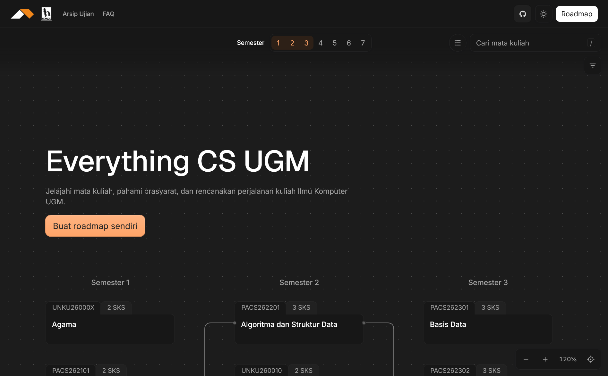
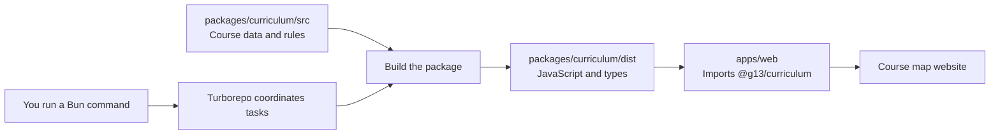

# g-13 — UGM Computer Science Course Map

A community-built, open-source guide to UGM Computer Science courses. Explore the
curriculum, see which courses depend on others, and sketch a semester-by-semester
study plan. A prerequisite is a course you need to take first.



Use the course map, search for a course, open its details, or try the roadmap. This
is a community project. It is **not an official UGM or department service**, and
the roadmap does not replace department rules.

## Run the project on your computer

You’ll need [Git](https://git-scm.com/downloads),
[Bun 1.4.3](https://bun.sh/docs/installation), and Node.js 22.12 or newer. Some
of the tools used to run and build the website need Node.js.

1. Download the project and enter its folder:

   ```sh
   git clone https://github.com/Andhiki/g-13.git
   cd g-13
   ```

2. Install the project’s dependencies:

   ```sh
   bun install --frozen-lockfile
   ```

3. Build the curriculum package:

   ```sh
   bun run build:packages
   ```

   The website uses this package. Build it once before starting the site, and
   again whenever you change its source files.

4. Start the website:

   ```sh
   bun run dev
   ```

   Open the local address printed in your terminal. It is usually
   `http://localhost:5173`.

Press `Ctrl+C` in the terminal to stop the website.

## How the project is put together

Bun installs dependencies and runs commands. Turborepo coordinates commands
across the website and curriculum package in this repository.



Each curriculum’s data and rules live in `packages/curriculum/`. Building that
package produces JavaScript and TypeScript declarations in `dist/`. The website
in `apps/web/` imports the built package as `@g13/curriculum` to show the map,
course details, and roadmap.

When you run `bun run build`, Turborepo builds the packages the website needs
first. Before `bun run dev`, build the curriculum package once with
`bun run build:packages`.

## Where to find things

- `apps/web/src/features/` — website features, including the course map,
  roadmap, and exam archive.
- `apps/web/src/ui/` — shared buttons, dialogs, and other interface pieces.
- `packages/curriculum/src/curricula/` — data and rules for each curriculum.
- `packages/curriculum/src/contracts/` — shared descriptions of the data’s shape.
- `docs/adr/` — important technical decisions.
- `AGENTS.d/` — contributor and agent workflows.

For website changes, start in `apps/web/`. For curriculum changes, start in
`packages/curriculum/` and include an official source. Read the
[curriculum import guide](AGENTS.d/curriculum-import.md) before changing
curriculum data.

## Want to contribute?

Everyone is welcome, including people who are new to programming.

- Have an idea or found a problem? [Open an issue](https://github.com/Andhiki/g-13/issues).
- Have a code or writing change ready? [Send a pull request](https://github.com/Andhiki/g-13/pulls).
- Before contributing, read the [contribution guide](CONTRIBUTING.md),
  [AGENTS.d](AGENTS.d/README.md), and [community guidelines](CODE_OF_CONDUCT.md).

Before sending a code change, run:

```sh
bun run check
```

This checks code style, formatting, TypeScript types, and tests. Fix any reported
problems, then run the command again.

Verify UI changes manually. Automated tests cover data and application logic, not UI text, layout, dimensions, or animations.

## Acknowledgements

- [course.csui.dev](https://course.csui.dev) inspired this project.
- [AlignUI](https://www.alignui.com) provides UI components used in this project.

## License and sources

Original code and documentation are available under the [MIT license](LICENSE).
Data, documents, logos, and other third-party materials have their own terms;
see [Third-Party Notices](THIRD_PARTY_NOTICES.md).
